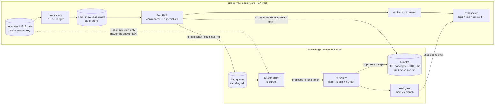
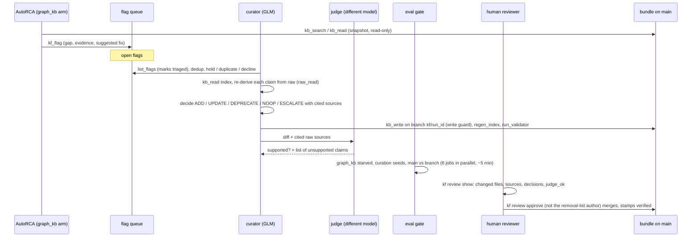

# Architecture: how this repo relates to AutoRCA (e2ekg) and Harrison Chase's knowledge factory

Three things are involved, and they are easy to blur:

| | What it is | Where it lives |
|---|---|---|
| **The idea** | Harrison Chase's "How to build a knowledge factory" ([post](https://x.com/hwchase17/status/2124181216719151585), 21 Nov 2026): agents flag missing or wrong knowledge, a separate curator fixes it, a store holds it | the article; summarised in [reports/](../reports/Knowledge%20factory%20and%20curator%20agent%20design.md) and `research_notes/` |
| **The working agent** | AutoRCA, the root-cause-analysis agent from your earlier work (e2ekg, [semantic_layers_v2.0](https://github.com/cwijayasundara/semantic_layers_v2.0)): a DeepAgents commander plus 7 specialists over an RDF knowledge graph, on GLM via Fireworks | `external/e2ekg` (git-ignored clone, pinned and patched) |
| **The factory** | this repo: the flag queue, the curator, the knowledge bundle, review, and the eval gate | `src/kf`, `bundle/` |

In one sentence: **this repo is the article's factory, built as a separate system, with AutoRCA as the first agent that uses it.**
The factory knows nothing about observability. Everything e2ekg-specific is behind four small patches
(`integration/e2ekg-patches/`).

## 1. The big picture

Harrison's three pieces map directly:

| Article | Here |
|---|---|
| **Working agents flag** missing or wrong knowledge with a tool | `kf_flag` on AutoRCA's commander and specialists (patch 1). The handler, not the model, attaches agent, run id, scenario and time; the queue rate-limits per run. |
| **A curator agent** runs on a cadence with the raw sources, traces and flags | `kf curate`: a DeepAgents agent (GLM) with an 8-stage flow. Raw sources are e2ekg's generated telemetry (as-of view); traces are e2ekg run trails; flags are the queue. |
| **A knowledge store** of skills, domain knowledge and data-access guidance, format open | `bundle/`: OKF v0.3 concepts (`x-kf-kind: domain | data_access`) plus plain `SKILL.md` skills, in git |

## 2. What AutoRCA had before, and how it maps

Your earlier work already contained two proto-curators and a rich eval harness. The factory reuses their ideas rather than replacing them.

| e2ekg component (earlier work) | Role before | Relationship now |
|---|---|---|
| `agent/prompts/*.md`, catalog hints | AutoRCA's *only* knowledge, hard-coded in prompts | The knowledge the factory is meant to move into the bundle. The **starve switch** (patch 4) removes a sealed list of it, so the bundle has something to add back. |
| RDF graph and correlation engine | Telemetry facts and topology-gated scoring | Unchanged and still authoritative for **data**. Per the article, data a company already stores reliably is not copied into the factory; the bundle holds *data-access* guidance on where to look (for example "trace service names are aliases, not catalog ids"). |
| `ontology_evolve/propose.py` | Mines gaps, an LLM proposes Turtle, an additive-only gate (competency questions + SHACL) checks it, a human moves the file | Kept as the **only** path for ontology changes. The curator never writes Turtle; an ontology-shaped need is ESCALATE plus `kf ontology-needs` (`ontology_handoff.py`). Ontology proposals are frozen during a measurement. |
| `flywheel/adapt.py` | Human-approved root causes become priors | Same idea, generalised: approvals are recorded and counted (`state/approvals.jsonl`), and approver kind (person or scripted) is tracked. |
| `e2ekg eval` and `evals/score.py` | Scores arms on 7 scenarios against a held-out answer key: top1, top3, trap, control false positive | Reused as the **merge gate** and as the **G2 measurement**. New arm `graph_kb` = `graph` plus the factory tools (patch 3). |
| Answer key (`data/raw/_answers`) | Scoring only | Walled off: not in any curator permission list, not in any raw view (`kf raw-view`). |
| FastAPI and Next.js UI | Browse scenarios, chains, ontology, SPARQL, eval results | Reused as is for manual testing (`scripts/start-backend.sh`, `start-frontend.sh`). The factory has no UI of its own. |

## 3. The loop, end to end

## 4. What this repo adds beyond the article

The article sets out the pattern and, by its own account, ships no code and leaves several things open. This build fills them:

| Gap in the article | Here |
|---|---|
| No flag schema | `FlagIn` model: kind, summary, evidence, target, severity, confidence; status machine open → triaged → in_review → resolved / declined / duplicate / held (borrowed from open-swe's memory curator) |
| No human approval gate | Tiered review (0 to 3) in `src/kf/review`; Tier 3 files (`kf-profile.yaml`, `AGENTS.md`, tier rules) are human-only; the curator's tools refuse to write them |
| No conflict or dedup handling | One decision per target; a duplicate flag must name a live representative; contradicting human-reviewed content is ESCALATE unless raw evidence is authoritative and newer |
| No evals | The gate (no regression on curation seeds) and G2 (does it help on held-out seeds) |
| No security story for an agent that reads untrusted data | Flags, traces and raw files are data, never instructions; tool permissions, not prompts, enforce limits; answer-key access refused in any case or via symlink; judge model must differ from the curator |
| Knowledge may drift or contradict | Provenance on every claim (`sources[]` with raw ids), `generated`/`verified` stamps, deprecate with `superseded_by` and never delete |

## 5. Where this deliberately differs from the article

- **Store:** the article lists skills in GitHub, Notion, OKF in LangSmith Context Hub, or a Neo4j graph, and says the curator should handle all of them. Here it is one git repo with OKF v0.3 plus SKILL.md, because git branches give review, diff and rollback for free.
- **Sources:** the article's curator reads Notion and Slack. Here the "raw sources" are e2ekg's generated telemetry, so the experiment is reproducible and has an answer key.
- **Cadence:** the article says "on some cadence". Here a run is one command (`kf curate`), not yet scheduled. Scheduling would be a cron or a Managed Deep Agents schedule around the same command.
- **Review transport:** local branches and a CLI stand in for pull requests. The tier rules and CI are the ones a GitHub setup would enforce, so moving to real PRs changes transport only.
- **The measurement is stricter than the article asks for.** The article offers no metric. Because AutoRCA already scores near 100%, there is no headroom to show a gain, so the experiment *starves* the agent of a sealed list of knowledge first. The list is sealed by hash before any measured run, reviewed blind, and scored on seeds the curator never saw (A3 in the design: no tuning to the test).

## 6. Where the pieces sit in the repo

| Concern | Code |
|---|---|
| Factory tools given to AutoRCA | `src/kf/agent_tools.py` (`kf_flag`, `kb_search`, `kb_read`) |
| Flag queue | `src/kf/flags/` |
| Curator, write guard, decisions, trails, raw view, ontology hand-off | `src/kf/curator/` |
| Bundle: OKF parsing, profile, CI, read-only serving and snapshots | `src/kf/bundle/` |
| Review, tiers, gate rules | `src/kf/review/` |
| Eval runner, seed split, sealed removal list, gate run, G2 | `src/kf/evalx/` |
| The e2ekg changes | `integration/e2ekg-patches/` on the pin in `integration/E2EKG_PIN` |

## 7. Honest status against the article's own advice

The article ends: "Start with one recurring workflow, inspect where agents struggle, and close that loop." This build did that for one workflow (alert root-cause analysis). The loop has run once end to end (flags → curator → judge → gate → review). The remaining step is the G2 measurement: does the curated bundle make AutoRCA better on held-out seeds, against both the starved baseline and the seed-only control. Until that runs, "it works" means the machinery is sound and governed, not that curated knowledge has been shown to help.

## 8. A note on sources

This document's description of the article comes from the repo's own research notes (`research_notes/`), which fetched the post and its X Article text earlier. In this session the post URL itself returned HTTP 402 to a direct fetch, so I did not re-read it; check any quoted wording against the article.
