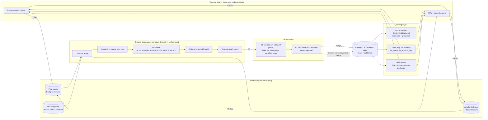

# Turn agent friction into curated company knowledge

Harrison Chase's November 21, 2026 article "How to build a knowledge factory" argues that the bottleneck for enterprise agents is **"not better models, it's not just more context - it's better knowledge"**. He proposes a loop with three parts. Working agents **flag** missing or wrong knowledge with a tool. A separate **curator agent** runs in the background on a schedule, reads those flags along with agent traces and raw sources like Notion and Slack, and updates the knowledge. A **knowledge store** holds three kinds of knowledge (skills, domain knowledge, data-access guidance), and he calls the store "the least important thing" ([Article](https://www.langchain.com/blog/knowledge-factory); also published as an [X article](https://x.com/i/article/2124180107669766144)). The post sets out the pattern but ships no code. It leaves out a flag schema, a review gate, conflict handling, evals and access control. Prior art fills most of those gaps: Karpathy's LLM Wiki, Letta's sleep-time agents, Graphiti's invalidate-don't-delete model, Guru's verification lifecycle and KCS. **LangChain has no reference implementation of a knowledge factory or curator agent as of November 21, 2026.** It does publish five reusable pieces: the deepagents `llm-wiki` example, the memory curator inside open-swe, `docs-release-watch`, the `memory_backed_agent` sample, and OpenWiki. The **Open Knowledge Format (OKF) v0.3** fits domain knowledge and data-access guidance well because its `generated`/`verified` trust tiers, `status`/`superseded_by` lifecycle and `stale_after` freshness fields encode exactly what a curator-plus-human review loop needs. It needs a small `x-kf-*` extension profile and stricter CI on top. Skills should stay in the standard SKILL.md format inside the same git repo. The design below is the report's own recommendation. It builds the factory as a git-backed OKF bundle that a scheduled deep agent maintains through pull requests, with approval tiered by risk, rolled out over four phases that start from one recurring workflow.

Throughout this report, statements are labelled by origin. **[Harrison]** marks what the article says, **[Prior art]** marks other published sources, and **[Design]** marks this report's own recommendations.

## Harrison's post defines three knowledge types and a flag-curate-serve loop

**[Harrison]** The article separates *context*, meaning what an agent has available during a task, from *knowledge*, "the reusable understanding we maintain so it can do that task correctly: what a metric means, which source to trust, or how we handle a particular situation." It defines a knowledge factory as the system that will "collect, curate, and maintain a representation of that knowledge to pass to agents". It frames this as the knowledge-work counterpart of the software factory, where your best people build the system rather than doing the work by hand ([Article](https://www.langchain.com/blog/knowledge-factory)). Knowledge is deliberately only one slice of context. Data that a company "already ingest[s]/store[s] reliably" should go straight to the agent instead of being copied into the factory.

The knowledge itself comes in three types. **Skills** are "procedures, instructions, and scripts for accomplishing tasks the way your company expects", and Chase says companies should strive to write them down because they are usually "passed coworker to coworker". **Domain knowledge** is "definitions, policies, and facts about your products, customers, competitors, and organization"; it goes stale slowly but is "usually incomplete (or incorrect)". **Data-access guidance** covers "which sources to use, what data lives where, and how to query it". If a warehouse such as Snowflake or Databricks is already complete and current, "there's no need to maintain a separate copy", and what you maintain instead is instructions on where data lives and how to query it ([Article](https://www.langchain.com/blog/knowledge-factory)). The article's first diagram pairs each type with an example and a home: a SKILL.md "Reports in LangChain style" in GitHub, a wiki page "How we calculate ARR" in the company wiki, and a query guide "Revenue: BigQuery and Salesforce" in Context Hub ([diagram 1](https://cdn.prod.website-files.com/65c81e88c254bb0f97633a71/6b01ca8ba227073b426bacc9_6b01ca1131dfcdcb792afbeb_knowledge-factory-pieces-of-knowledge.png)).

The factory has three pieces. First, agents get a tool to flag gaps: "Give the agent a tool to at a minimum report what is wrong, and optionally suggest the correct update." Second, a **curator agent** "runs in the background, on some cadence" with access to "all the raw sources of data (Notion, Slack, etc)", to agent traces "so it can see how people are trying to use agents and codify that into skills", and to the flags. Third, storage can be "skill format in GitHub. In a single file in Notion. In OKF format in LangSmith Context Hub. In a knowledge graph in Neo4j." The curator "should know how to interact with all of these formats." Chase notes that the industry has converged on skills for procedural memory, while for semantic memory "a different standard will likely emerge (OKF?)", and he advises against being "too prescriptive" ([Article](https://www.langchain.com/blog/knowledge-factory)). The load-bearing architectural decision is the **split between flagging and fixing**. Agents that use the knowledge "are great at flagging what's wrong or missing", but asking them to maintain it "will cause it to become unruly and full of contradictions" ([Article](https://www.langchain.com/blog/knowledge-factory)).

The worked example makes the loop concrete. A revenue-report agent finds that a BigQuery column has been renamed, works around it, and flags it with a suggested fix. A finance lead then corrects the report live and asks for a new header on "all LangChain documents". That night the curator reads the flag and the trace of that conversation, and updates two skills: data fetching (new column) and report drafting (new header) ([diagram 3](https://cdn.prod.website-files.com/65c81e88c254bb0f97633a71/6b01ca8ba227073b426baccc_6b01ca11a227073b426b930c_knowledge-factory-revenue-report.png)). The article closes with its operating advice: "Start with one recurring workflow, inspect where agents struggle, and close that loop." Chase says LangChain's internal GTM and content-studio agents run on such a factory, and that LangSmith Engine "maintains a knowledge factory per agent" ([Article](https://www.langchain.com/blog/knowledge-factory)).

The article omits several things. It gives **no flag schema**, **no human approval gate** before curator edits take effect, no conflict-resolution or dedup strategy, no evals, no metrics, and nothing on the security surface of an agent that reads Slack and Notion and writes to a shared store. Related LangChain writing supplies part of the missing governance. Context Hub lets teammates "review, comment, and promote versions" of versioned context ([Context Hub launch](https://www.langchain.com/blog/introducing-context-hub)). LangChain's memory post warns that "not everything should be a memory update" and that behaviour-shaping updates should be protected with evals ([memory post](https://www.langchain.com/blog/how-to-give-your-agent-memory)). Reaction to the post itself is thin. The 97 replies could not be retrieved. In an earlier November 19 exchange, known only from search snippets and so unverified, Snowflake CEO Sridhar Ramaswamy replied "most companies don't need a knowledge factory", and Chase answered that inconsistent revenue definitions are exactly why you would need one ([search-snippet source](https://x.com/RamaswmySridhar)).

## Prior art already solved most of what the post leaves open

**[Prior art]** Karpathy's **LLM Wiki** gist (April 4, 2026) is the closest blueprint. It has three layers: immutable raw sources that the LLM "reads but never modifies", an LLM-owned interlinked Markdown wiki, and a schema file (CLAUDE.md/AGENTS.md) that makes the LLM "a disciplined wiki maintainer". It runs three operations. *Ingest* can touch 10-15 pages per source. *Query* answers with citations. *Lint* looks for contradictions, stale claims, orphan pages and missing cross-references. An `index.md` catalog is enough at roughly 100 sources and hundreds of pages without embeddings ([Karpathy gist](https://gist.github.com/karpathy/442a6bf555914893e9891c11519de94f)). Chase's own earlier "Wiki Memory" post endorses the same file-based layer because files are "inspectable, editable, versionable" ([Wiki Memory](https://www.langchain.com/blog/wiki-memory)). The gist leaves provenance, verification and concurrency unspecified. A community catalogue of failure modes lists the fixes, which are now standard: claim-level provenance, a status lifecycle, git-diff review, "Don't rewrite summaries of summaries" (re-derive from raw), and the warning that "prompt rules are not a security boundary; tool permissions are" ([po4yka criticism-and-mitigations](https://github.com/po4yka/llm-wiki-skills/blob/main/docs/criticism-and-mitigations.md)).

Memory research supports Chase's reader/curator split. Letta's **sleep-time agents** remove memory-editing tools from the primary agent and give them to an asynchronous agent, because incremental memory formation "can become messy and disorganized over time" ([Letta](https://www.letta.com/blog/sleep-time-compute/)). The related paper reports about **5x less test-time compute** at equal accuracy ([arXiv:2504.13171](https://arxiv.org/abs/2504.13171)). Letta's Context Repositories auto-commit every memory change to git, isolate subagents in worktrees, and run a "Defragmentation" skill that reorganizes memory into 15-25 focused files after taking a backup ([Letta Context Repositories](https://www.letta.com/blog/context-repositories/)). Three contradiction strategies compete. Graphiti invalidates the old edge with time bounds and keeps its history ([arXiv:2501.13956](https://arxiv.org/html/2501.13956)). The Mem0 paper chooses ADD/UPDATE/DELETE/NOOP against the top-10 similar memories ([arXiv:2504.19413](https://arxiv.org/html/2504.19413v1)). Mem0 v3 moved to ADD-only and leaves resolution to retrieval ranking ([Mem0 v3 migration](https://docs.mem0.ai/migration/oss-v2-to-v3)). For an *authoritative* company knowledge base, invalidating rather than deleting is the defensible choice, because ADD-only leaves stale facts in place for readers to trip over.

Enterprise knowledge tools add the governance layer. In **Guru**, every card has a verifier, an edit by anyone else unverifies the card, review intervals run from 30 days to a year, and agents can be restricted to verified content. Its automated verification runs unverify rules before verify rules and writes each decision to a Quality Log with a confidence level ([Guru help](https://help.getguru.com/docs/verifying-and-unverifying-cards)). **KCS v6** contributes "Reuse is Review" and the principle that "knowledge is best managed at the point of creation, in the context of demand" ([KCS v6](https://library.serviceinnovation.org/KCS/KCS_v6/KCS_v6_Practices_Guide/041)). That principle matches Chase's flag-driven approach and argues for prioritizing curation by usage. Security research gives a hard constraint: the MINJA attack shows that query-only users can plant malicious records in agent memory ([arXiv:2503.03704](https://arxiv.org/abs/2503.03704)). Flags and traces are therefore untrusted input to the curator, never instructions. On retrieval, the evidence favours an index plus grep/read navigation before a vector store. Anthropic recommends just-in-time loading with progressive disclosure ([Anthropic context engineering](https://www.anthropic.com/engineering/effective-context-engineering-for-ai-agents)). A 2026 study found that the harness changed accuracy as much as the choice of retriever (Opus 4.6 moved from 93.1% to 76.7%), so retrieval should be evaluated inside the actual consumer harness ([arXiv 2605.15184](https://arxiv.org/html/2605.15184v1)).

## LangChain ships the parts but no assembled factory

**[Prior art]** Searches across langchain-ai and langchain-samples found no repo named or packaged as a knowledge factory or curator template. GitHub returned **zero** "knowledge factory" repos created since November 18, 2026. The article links no implementation code. Its only GitHub link is the [OKF spec repo](https://github.com/open-knowledge-format/open-knowledge-format), and its docs links point to [Deep Agents skills](https://docs.langchain.com/oss/python/deepagents/skills) and [Managed Deep Agents schedules](https://docs.langchain.com/langsmith/python/managed-deep-agents-schedules) ([langchain_sample_repos research; GitHub search](https://github.com/search?q=%22knowledge+factory%22&type=repositories)). The only literal "curator" in LangChain code is embedded in **open-swe**. There, a thread's `remember` call saves a memory that "waits for the workspace's curator, which may fold what many threads learned into the workspace's prompt. Each curated prompt is kept as a new version" ([open-swe migration 0087](https://github.com/langchain-ai/open-swe/blob/main/openswe/database/migrations/versions/0087_e0605414666c_keep_memories_and_each_workspace_s_.py)). Memories move through the states `pending`, `held`, `adopted`, `superseded` and `declined` ([migration 0089](https://github.com/langchain-ai/open-swe/blob/main/openswe/database/migrations/versions/0089_5f101256cbc0_let_the_curator_supersede_a_memory.py)), and the curator's thread is read-only to users ([summary.py](https://github.com/langchain-ai/open-swe/blob/main/openswe/threads/summary.py)). It is the clearest in-house precedent for "agents propose, one curator decides", and its state machine is worth copying for flags.

| Piece | Repo / source | What to reuse | What it lacks |
|---|---|---|---|
| Curation mechanics (ingest/query/lint, `log.md`, Context Hub revision per run) | [deepagents `examples/llm-wiki`](https://github.com/langchain-ai/deepagents/tree/main/examples/llm-wiki) | Curator prompts and modes; lint for contradictions, stale claims and orphans; push-per-run for review | No flag tool, no schedule (CLI-driven), local files only |
| Proposal → curator → versioned output | [open-swe memory curator](https://github.com/langchain-ai/open-swe) | Status machine (pending/held/adopted/superseded/declined); path "triggers" for scoping guidance | Product-embedded; writes a prompt, not SKILL.md/OKF; cadence unknown |
| Scheduled background agent maintaining an artifact | [docs `docs-release-watch`](https://github.com/langchain-ai/docs/tree/main/docs-release-watch) | Managed Deep Agent cron schedules, `skills/` + `tools/` layout, draft PRs and tickets, Context Hub hot memory ("a trust boundary") | Curates public docs, not agent knowledge |
| Traces → issues against the agent's memory repo | [`memory_backed_agent`](https://github.com/langchain-samples/deepagents-with-langsmith/tree/main/agents/memory_backed_agent) | `CompositeBackend` routing `/memories/` to `ContextHubBackend`; LangSmith Engine "runs on a schedule, analyzes traces, and files issues" | Engine proposes, never merges ([Engine docs](https://docs.langchain.com/langsmith/engine)); no flag input |
| OKF output from Notion/Slack/git with scheduled updates | [OpenWiki](https://github.com/langchain-ai/openwiki) | Connectors, claim grounding against evidence, OKF writer | Emits OKF **v0.2**; does not read LangSmith traces; wiki pages, not skills |
| Storage primitive | [`ContextHubBackend`](https://github.com/langchain-ai/deepagents/blob/main/libs/deepagents/deepagents/backends/context_hub.py) | Commit per write, rollback, environment tags | Native OKF validation in Context Hub is unconfirmed |
| Eval-gated self-improvement | [deepagents `better-harness`](https://github.com/langchain-ai/deepagents/tree/main/examples/better-harness) | Keep a change only if train and holdout evals improve; template for gating skill edits | Not knowledge curation |
| Background consolidation primitive | [LangMem `ReflectionExecutor`](https://github.com/langchain-ai/langmem) | Delayed or debounced reflection | Vector memory, not files |
| Hosted memory, schedules and identity | [Managed Deep Agents memory](https://docs.langchain.com/langsmith/python/managed-deep-agents-memory), [schedules](https://docs.langchain.com/langsmith/python/managed-deep-agents-schedules) | Context Hub-backed `/memories/agent/` (shared by every caller) and `/memories/user/` (per authenticated person); `AGENTS.md` at a mount root is hot memory, other files load on demand; `define_schedule(cron=..., thread={"mode": "persistent"}, deliver_to=...)` for a nightly curator run; opt-in write approval with `FilesystemPermission(operations=["write"], paths=["/memories/**"], mode="interrupt")` | The working agent writes memory directly by default; no versioning, review queue or curation pipeline described; skills are deploy-synced and read-only to the agent |
| Trace → issue → fix PR → eval gate | [gtm-agent-engine-workshop](https://github.com/langchain-samples/gtm-agent-engine-workshop) | `.github/workflows/eval.yml` runs `eval.py` on the PR's base and head commits and comments both experiments; assertion-style LLM-judge evals; Engine reopens a closed issue when the failure recurs | Engine fixes agent code and prompts, not knowledge; domain rules are hardcoded in prompts; no flag tool, skills or memory |

The practical conclusion is that a team can assemble a factory today from official parts. Take `docs-release-watch`'s schedule and layout, `llm-wiki`'s curation modes, `ContextHubBackend` or a git checkout for storage, and OpenWiki's connectors and OKF writer, then add the flag tool, which no LangChain sample implements. Community projects such as [violetfleming47/agent-knowledge-curator](https://github.com/violetfleming47/agent-knowledge-curator) and [fvanevski/knowledge_agent](https://github.com/fvanevski/knowledge_agent) are only loosely related. Re-run the searches in a few weeks, because the post is less than a day old.

**[Prior art]** LangChain's "company harness" post (Chase and Broekhuizen, October 24, 2026) describes the platform under its internal GTM, OpenSWE and Content Studio agents: Slack as the interface, per-service identity (acting on behalf of the user vs. a fixed identity), global and per-user memory, sandboxed code execution, and scheduled "ambient" runs. It calls memory "probably the least explored area so far" and links no code ([company harness](https://www.langchain.com/blog/components-building-company-harness)). The knowledge factory article links back to it, so the harness is the platform the factory is meant to run on. One default in the Managed Deep Agents docs cuts against Chase's split between flagging and fixing. Memory writes come from the working agent itself, and the runtime's rule against saving caller-specific data to shared agent memory is prompt-level: "nothing enforces it" ([memory docs](https://docs.langchain.com/langsmith/python/managed-deep-agents-memory)). **[Design]** A factory built on Managed Deep Agents should therefore deny writes to (or interrupt on) `/memories/agent/**` in the working agents and leave shared knowledge writes to the curator. It should also treat anything already in shared agent memory as untrusted input, because the docs say it is "readable by every caller."

## OKF fits the semantic layer once a thin extension profile is added

**[Prior art]** OKF represents knowledge as "plain markdown files with YAML frontmatter", is "not tied to any particular agent, framework, model provider, or serving system", and puts bundles in git so that "knowledge curation becomes a normal software-engineering activity" ([OKF README](https://github.com/open-knowledge-format/open-knowledge-format)). Version 0.3 is motivated explicitly by agent-maintained corpora: "Agents write and maintain the corpus continuously", so consumers need "provenance, trust, freshness, lifecycle, attestation" ([SPEC.md](https://github.com/open-knowledge-format/open-knowledge-format/blob/main/SPEC.md)). The trust mechanics match a curator loop closely. `generated: {by, at}` records the last meaningful change. `verified` is a list of `{by, at}` events. A concept is **human-reviewed** only when a `human:` verification is at or after `generated.at`. "When an agent rewrites a concept after a human review… the concept is not human-reviewed until a human confirms it again" ([SPEC §5.3](https://github.com/open-knowledge-format/open-knowledge-format/blob/main/SPEC.md)). Every curator rewrite therefore demotes trust mechanically, with no extra bookkeeping. Lifecycle is handled by `status: draft|stable|deprecated` plus `superseded_by`. `stale_after` is an absolute instant meaning "check again, not false". `sources[]` with ids supports per-claim footnote citations. Producers may add `x-<producer>-<name>` keys, and consumers "MUST NOT reject unknown keys". **Attested Computation** concepts let a governed SQL metric be executed but never edited by an agent: "The agent MUST NOT write or edit the computation" ([SPEC §4.1, §5, §10](https://github.com/open-knowledge-format/open-knowledge-format/blob/main/SPEC.md)). Untyped `SKILL.md`, `README.md` and `AGENTS.md` files can live inside a bundle and are skipped as non-concepts ([SPEC §3.2](https://github.com/open-knowledge-format/open-knowledge-format/blob/main/SPEC.md)).

OKF has real limits. It is **pre-1.0**, and a minor version "MAY contain breaking changes"; v0.3 shipped two. It is Apache-2.0 but effectively run by two Google engineers under a Google CLA ([SPEC §12-13](https://github.com/open-knowledge-format/open-knowledge-format/blob/main/SPEC.md); [CONTRIBUTING](https://github.com/open-knowledge-format/open-knowledge-format/blob/main/CONTRIBUTING.md)). It has no confidence score, no typed relations (proposed in [issue #11](https://github.com/open-knowledge-format/open-knowledge-format/issues/11)), no review states beyond `draft`, no access control ("Trust tiers are advisory signals, not access control"), and no guidance for concurrent writers. Regenerated `index.md` and `log.md` files collide on merge ([GCP repo issues](https://github.com/GoogleCloudPlatform/open-knowledge-format/issues)). Effectiveness evidence is thin. In one secondary test, frontmatter alone made no measurable difference, while restructuring into one concept per file plus an index roughly halved startup tokens ([dev.to analysis](https://dev.to/amananandrai/googles-open-knowledge-format-from-a-karpathy-tweet-to-a-spec-and-what-the-evidence-says-ol8)). OKF's value is therefore governance structure, not retrieval magic. There is also an ecosystem split to watch: LangChain's OpenWiki emits v0.2 and links the old GoogleCloudPlatform spec location ([OpenWiki README](https://github.com/langchain-ai/openwiki)).

**[Design] Verdict: yes, maintain domain knowledge and data-access guidance in OKF v0.3. Keep skills as standard SKILL.md in the same repository.** This matches Chase's own split between procedural and semantic memory. It costs nothing in lock-in because the files are plain Markdown, and it hands the curator a ready-made trust vocabulary plus official tooling: `validate.py --strict`, and the `okf-generate` and `okf-consume` skills, including okf-generate's rule "Do not add a `verified` entry to content that you generated in this run" ([okf-generate SKILL.md](https://github.com/open-knowledge-format/open-knowledge-format/blob/main/skills/okf-generate/SKILL.md)). Leave SKILL.md files untyped so standard skill loaders read them unchanged. Adding `type:` to a SKILL.md would make it an OKF concept, but how skill loaders handle extra keys is untested here, so govern skills through git history and CODEOWNERS instead. Pin `okf_version: "0.3"` and treat spec upgrades as migrations.

### Bundle layout

```text
company-knowledge/                      # git repo, protected main branch
├── .github/CODEOWNERS                  # ownership per directory (Tier routing)
├── .github/workflows/kf-ci.yml         # validate.py --strict, kf-profile lint, link check, PII scan, LLM judge
├── AGENTS.md                           # curator conventions (the Karpathy "schema" layer; untyped, skipped by OKF)
├── kf-profile.yaml                     # required keys per type, allowed types, TTL defaults (factory-specific)
├── raw/                                # immutable, content-hashed snapshots (outside the bundle; never cited as compiled pages)
│   └── slack/2026-11-21/C0FIN-1732.json
└── bundle/                             # the OKF bundle root
    ├── index.md                        # okf_version, title, description, license (root frontmatter)
    ├── log.md                          # one dated entry per curator run (written once per run, serialized)
    ├── domain/
    │   ├── index.md
    │   ├── metrics/arr.md              # type: Metric
    │   ├── policies/document-branding.md   # type: Policy
    │   └── glossary/net-new-arr.md     # type: Glossary Term
    ├── data-access/
    │   ├── index.md
    │   ├── bigquery/finance.revenue_daily.md   # type: BigQuery Table
    │   ├── salesforce/opportunity.md           # type: Salesforce Object
    │   └── guides/revenue-sources.md           # type: Query Guide (which source for what)
    ├── computations/arr_monthly.md     # type: Attested Computation (human-only edits)
    └── skills/
        ├── index.md
        ├── revenue-data-fetch/SKILL.md # untyped Agent Skill, plus scripts/
        └── report-drafting/SKILL.md
```

Flags and curator run records deliberately live **outside** the bundle, in a database or issue tracker. They are operational state, not knowledge, and putting them in the bundle would pollute agent context.

### Extension profile (`x-kf-*`)

| Key | Values | Why OKF needs it |
|---|---|---|
| `x-kf-kind` | `domain` \\| `data_access` \\| `skill_card` | Maps to Chase's three types for routing and TTL defaults |
| `x-kf-owner` | `team:finance-data` | Named owner/verifier (Guru pattern); mirrors CODEOWNERS |
| `x-kf-review` | `proposed` \\| `in_review` \\| `approved` \\| `rejected` | OKF only has `draft`; tracks PR state on the file |
| `x-kf-risk` | `0`-`3` | Approval tier (see governance table) |
| `x-kf-confidence` | `low` \\| `medium` \\| `high` | OKF has no confidence; categorical rather than spurious decimals |
| `x-kf-relations` | list of `{type, target, kind, evidence}` | Shaped like OKF issue #11 so it can migrate when typed relations land |
| `x-kf-valid` | `{from, to}` | Validity windows are deferred in v0.3; lets the curator invalidate instead of delete (Graphiti) |
| `x-kf-flags` | list of flag ids resolved by the latest change | Traces a change back to the demand that caused it |
| `x-kf-usage` | `{reads_30d, last_read}` | KCS "reuse is review": drives re-verification priority |

### Frontmatter examples

A human-reviewed domain metric, cited claim by claim:

```markdown
---
type: Metric
title: Annual Recurring Revenue (ARR)
description: How LangCo calculates ARR for board and finance reporting.
tags: [finance, revenue, board]
resource: https://wiki.example.com/finance/arr
generated: { by: "kf-curator/0.4.1", at: "2026-10-02T02:14:00Z" }
verified:
  - { by: "human:maria.chen", at: "2026-10-03T16:20:00Z" }
status: stable
stale_after: "2027-04-01"
sources:
  - { id: fin-wiki-arr, resource: "https://wiki.example.com/finance/arr", author: "human:maria.chen", last_modified: "2026-09-30" }
  - { id: slack-fin-1732, resource: "raw/slack/2026-09-29/C0FIN-1732.json", title: "ARR excludes one-time services" }
x-kf-kind: domain
x-kf-owner: "team:finance"
x-kf-risk: 2
x-kf-review: approved
x-kf-confidence: high
---
# Definition
ARR is the sum of annualized recurring subscription value for active contracts at period end.[^fin-wiki-arr]
One-time professional-services fees are excluded.[^slack-fin-1732]

# Computation
Use the sanctioned computation [arr_monthly](/computations/arr_monthly.md); never re-derive ARR in ad-hoc SQL.
```

The data-access concept after the overnight curator run in Chase's renamed-column example. A machine wrote it and no human has re-verified it yet, so it is unverified and pending review:

~~~~markdown
---
type: BigQuery Table
title: finance.revenue_daily
description: Daily recognized revenue by account; primary source for revenue reports.
resource: bigquery://langco-prod/finance/revenue_daily
generated: { by: "kf-curator/0.4.1", at: "2026-11-22T02:07:00Z" }
verified:
  - { by: "human:raj.patel", at: "2026-08-11T10:00:00Z" }   # history kept; no longer current
status: stable
stale_after: "2027-02-22"
sources:
  - { id: bq-schema, resource: "bigquery://langco-prod/finance/revenue_daily#schema", last_modified: "2026-11-19T08:00:00Z" }
  - { id: flag-0193, resource: "kf://flags/0193", title: "revenue-report agent: column arr_usd not found" }
x-kf-kind: data_access
x-kf-owner: "team:finance-data"
x-kf-risk: 1
x-kf-review: in_review
x-kf-flags: ["0193"]
x-kf-relations:
  - { type: supported_by, target: "/domain/metrics/arr.md" }
---
# Schema
| column | type | notes |
|---|---|---|
| account_id | STRING | joins to Salesforce Account.Id |
| recognized_arr_usd | NUMERIC | renamed from `arr_usd` on 2026-11-19[^bq-schema][^flag-0193] |

# Examples
```sql
SELECT DATE_TRUNC(day, MONTH) AS month, SUM(recognized_arr_usd) FROM finance.revenue_daily GROUP BY 1
```
~~~~

The root `index.md` and a `log.md` entry:

```markdown
---
okf_version: "0.3"
title: LangCo company knowledge
description: Definitions, policies and data-access guidance for LangCo's finance, GTM and content agents.
license: LicenseRef-Internal
---
# Domain
* [Domain knowledge](domain/index.md) - metrics, policies and glossary
# Data access
* [Data access guidance](data-access/index.md) - which source to use and how to query it
# Skills
* [Skills](skills/index.md) - procedures for recurring work (Agent Skills format)
```

```markdown
## 2026-11-22
**Update** data-access/bigquery/finance.revenue_daily: `arr_usd` renamed to `recognized_arr_usd` (flag 0193, schema diff). Run kf-run-0412, PR #287.
**Update** skills/report-drafting: new required header for all LangCo documents, from finance-lead correction in trace 7f3a… (Tier 1, owner team:finance).
```

Renames and retirements follow the spec. Keep the old file with `status: deprecated` and `superseded_by`; never delete it ([SPEC §5.4](https://github.com/open-knowledge-format/open-knowledge-format/blob/main/SPEC.md)).

## A concrete design for the factory and its curator

**[Design]** Everything in this section is the report's own recommendation. It is assembled from Chase's loop plus the prior art above, and it targets the LangChain stack while keeping the store portable. One principle runs through it: **working agents never write knowledge; one curator writes; humans approve by risk**.

### Architecture



The components and their recommended implementations are as follows. Working agents are existing Deep Agents with the knowledge mounted read-only and `kf_flag` added. The flag queue is a Postgres table or GitHub issues with the label `kf-flag`. The curator is a `create_deep_agent` with a `CompositeBackend`: `/kb/` routes to a git worktree on a fresh branch through a `FilesystemBackend` in virtual mode, `/raw/` routes to a read-only backend, and scratch stays in state. `FilesystemPermission` denies writes to `/raw/**`, `/kb/computations/**`, `CODEOWNERS` and `kf-profile.yaml` ([deepagents backends](https://docs.langchain.com/oss/python/deepagents/backends)). It runs on a Managed Deep Agents schedule as in `docs-release-watch`, or on `claude-code-action` with a cron trigger and an `--allowedTools` allowlist ([Claude Code GitHub Actions](https://code.claude.com/docs/en/github-actions)). The store of record is git. Context Hub can be a mirror pushed on merge for agents that use `ContextHubBackend`, which follows OKF's own connector advice: "Treat git as authoritative: push on merge" ([connector doc](https://github.com/open-knowledge-format/open-knowledge-format/blob/main/connectors/gcp-knowledge-catalog.md)).

### Data model

```text
Flag            id, created_at, agent_id, run/trace_id, workflow, kind, target, observed, expected,
                suggested_fix, evidence[], severity, confidence, status, cluster_id, resolution{pr, concept_ids}
Flag.status     open → triaged → (clustered) → in_pr → resolved | declined | duplicate | held   (open-swe-style)
RawSnapshot     id, connector, uri, fetched_at, content_hash, acl_label        (immutable; under raw/)
Concept         OKF file (frontmatter per kf-profile) — id = path without .md
Skill           SKILL.md + scripts/ (Agent Skills format) — governed by git + CODEOWNERS
CurationRun     run_id, started/finished, inputs{flags[], trace_ids[], raw_ids[]}, decisions[], pr_url, cost, model
Decision        run_id, target, op (ADD|UPDATE|DEPRECATE|NOOP|ESCALATE), rationale, sources[], confidence, tier
```

### The flag tool

Chase asks for "at a minimum report what is wrong, and optionally suggest the correct update". The schema keeps those two fields required-light and makes everything else optional, so agents flag freely instead of skipping the flag because filling it in is too much work.

```json
{
  "name": "kf_flag",
  "description": "Report knowledge that was missing, wrong, stale, ambiguous or contradictory while doing your task. Do not stop your task to fix knowledge; flag it and continue with your best workaround.",
  "input_schema": {
    "type": "object",
    "required": ["kind", "summary"],
    "properties": {
      "kind": { "enum": ["missing", "incorrect", "stale", "ambiguous", "contradiction", "procedure_gap"] },
      "summary": { "type": "string", "maxLength": 500, "description": "What is wrong, in one or two sentences." },
      "target": { "type": "string", "description": "Concept path or skill name if known, e.g. /data-access/bigquery/finance.revenue_daily.md" },
      "knowledge_type": { "enum": ["skill", "domain", "data_access", "unknown"] },
      "observed": { "type": "string", "description": "What the knowledge said or what you could not find." },
      "expected": { "type": "string", "description": "What you found to be true and how." },
      "suggested_fix": { "type": "string", "description": "Optional proposed replacement text or diff." },
      "evidence": {
        "type": "array",
        "items": { "type": "object", "required": ["resource"],
                   "properties": { "resource": { "type": "string" }, "excerpt": { "type": "string", "maxLength": 1000 } } }
      },
      "workaround_used": { "type": "string" },
      "severity": { "enum": ["low", "medium", "high"], "description": "high = would have produced a wrong answer silently" },
      "confidence": { "enum": ["low", "medium", "high"] }
    }
  }
}
```

The tool handler, not the model, attaches `agent_id`, `trace_id`, `workflow`, the user and a timestamp, and rate-limits flags per run. It writes only to the queue and never to the bundle. Its return value tells the agent to continue its task.

### The curator loop

The curator runs nightly, and also early when a burst of high-severity flags arrives for the same target. Each run is one branch and one PR, which suits Karpathy's observation that a single source touches many pages.

| Stage | What happens | Tools | Guardrails |
|---|---|---|---|
| 1. Collect | Pull open flags, LangSmith traces since last run (filtered to runs with human corrections, tool errors, or negative feedback), Engine issues, and raw-source deltas by content hash or `updated_at` | `list_flags`, `search_traces`, `fetch_engine_issues`, connector `fetch_delta` (writes raw/) | Ingest subagent has no write access to /kb/ and no shell; content is treated as data |
| 2. Triage and cluster | Dedup flags by target and semantics; cluster with matching trace evidence; drop noise; mark held when evidence is insufficient | `cluster_flags`, `update_flag_status` | Never act on a single low-confidence flag for Tier 2+ targets |
| 3. Locate | Find the concept(s)/skill(s) affected; read `index.md` first, then grep/read; retrieve neighbours | `kb_ls`, `kb_grep`, `kb_read`, `okf_scan --stale --unverified` | Read the current main, not prior curator output |
| 4. Re-derive | Verify the claim against **raw** evidence (schema, wiki, Slack thread, trace), never against summaries of summaries | `raw_read`, `query_metadata` (e.g. BigQuery INFORMATION_SCHEMA, read-only) | Each new claim needs a source id; no source means ESCALATE, not write |
| 5. Reconcile | Choose ADD / UPDATE / DEPRECATE (+`superseded_by`, `x-kf-valid.to`) / NOOP / ESCALATE per target; decide skill vs domain vs data-access placement | `decide` (structured output, logged as Decision) | Contradictions with human-reviewed content are ESCALATE unless raw evidence is authoritative and newer |
| 6. Write | Edit files on `kf/<run-id>`; set `generated`; keep unknown keys and `verified` history; update `index.md`; append one `log.md` entry | `kb_write`, `kb_edit`, `regen_index` | Never add `verified`; never touch Attested Computation code; no deletes |
| 7. Validate | Run `validate.py --strict`, kf-profile lint, link check; self-review diff against sources; compute risk tier labels | `run_validator`, `diff_review` | Fails block PR creation |
| 8. Propose and close | Open PR with summary table (decision, sources, flags resolved, tier); link flags to PR; post digest to owner channel | `open_pr`, `update_flag_status`, `notify` | Bot is not on the branch-protection bypass list |

Two placement rules settle the question Chase leaves open about which kind of knowledge to edit. A correction to **how** to do a task, such as a header, a format or a sequence of steps, goes into the skill. A correction to **what is true**, such as a definition, a policy or a column name, goes into the OKF concept, and the skill links to that concept instead of copying it. Without this rule the same fact ends up stored in two places, and it is the main source of the "unruly and full of contradictions" knowledge Chase warns about.

### Review and approval tiers

| Tier | Change class | Approval | Enforcement |
|---|---|---|---|
| 0 | `index.md` regeneration, link repair, formatting, `x-kf-usage` refresh, machine re-confirmation of an unchanged concept (append non-human `verified`, `generated.at` unchanged) | Auto-merge after CI | Separate ruleset for paths and labels; CI asserts no body change |
| 1 | Data-access guidance updates backed by a schema diff; skill edits from an explicit human correction in a trace; new concepts with ≥1 cited raw source | One domain owner (CODEOWNERS) | Required review; dismiss stale approvals |
| 2 | Domain definitions, policies, finance, legal and security paths; deprecations; resolving a contradiction with human-reviewed content; anything with `x-kf-confidence: low` | Owner + second reviewer; LLM-judge check must pass | CODEOWNERS on directories; 2 approvals |
| 3 | Attested Computation code, `kf-profile.yaml`, CODEOWNERS, curator prompt/AGENTS.md | Humans only; the curator may open a flag but not a diff | Path deny in agent permissions + ruleset path restriction |

At merge, a CI step appends `verified: {by: "human:<approver>", at: <merge time>}` to each approved concept, which lifts it to human-reviewed under OKF's rules. The approver's id comes from the PR approval, never inferred from git config, as okf-generate requires. The rulesets follow GitHub's Copilot-agent model: the agent cannot approve its own PR, and required checks still apply ([GitHub risks and mitigations](https://docs.github.com/en/copilot/concepts/agents/coding-agent/risks-and-mitigations); [rulesets](https://docs.github.com/en/repositories/configuring-branches-and-merges-in-your-repository/managing-rulesets/available-rules-for-rulesets)). This deliberately departs from Chase's narrative, in which the curator updates skills overnight with no stated gate. Tier 1 can relax to auto-merge for a given path once workflow evals show the curator's merged changes are rarely reverted.

### Serving

Working agents get the knowledge in three ways that share one source. Agents with file access mount the bundle or Context Hub, read `index.md` first, and navigate with grep and read. Remote agents use a read-only MCP server exposing `kf_search`, `kf_read` and `kf_flag`; write tools never appear on consumer-facing servers. Procedural knowledge loads through the standard skills mechanism. By default, serving filters to **current** knowledge: status `stable`, not past `stale_after`, `x-kf-review` not `proposed`. Conflicts resolve in okf-consume's order (status, trust tier, freshness, later `generated.at`), and both answers are surfaced when nothing decides ([okf-consume trust.md](https://github.com/open-knowledge-format/open-knowledge-format/blob/main/skills/okf-consume/references/trust.md)). High-stakes workflows such as board reporting can require human-reviewed concepts only, which is Guru's "answer only from verified" setting. Add BM25 plus vector search with contextualized chunks only once the corpus outgrows the index, and measure the choice in the real harness. Contextual retrieval cut retrieval failures by up to 67% in Anthropic's tests ([Contextual Retrieval](https://www.anthropic.com/news/contextual-retrieval)). Access control comes from **separate bundles or repos per audience**, because OKF has none and git read access is all-or-nothing.

### Evals

Evaluation runs at three levels in LangSmith ([LangSmith evaluation concepts](https://docs.langchain.com/langsmith/evaluation-concepts)). At the workflow level, a golden dataset of 30-100 tasks per adopted workflow (for example "Q3 revenue report" with reference outputs and rubric) runs as an offline experiment against the PR branch and against main. A drop blocks merge, which is the `better-harness` keep-only-if-better rule applied to knowledge. At the curator level, track PR acceptance rate, revert rate within 30 days, flag-to-resolution time, the share of flags declined or held, and **flag recurrence**: the same flag reappearing after a "resolved" PR is the clearest curator failure signal. Online LLM-judge rules on curator traces check that every changed claim is supported by its cited raw source; pairwise judging compares old and new pages. At the corpus level, monitor citation coverage, human-reviewed ratio, stale ratio, orphan and broken-link counts, contradiction-queue size and duplicate rate. These metrics are design proposals, because no standard KB-quality metric set was found. One more caution belongs here: lint run by the same model that wrote the content is circular ([tekai.dev review](https://tekai.dev/catalog/llm-wiki-pattern)). Run the judge on a different model, and spot-check a random sample of pages by hand each month.

## A four-phase rollout starts with one recurring workflow

**[Design]** The rollout follows Chase's advice to "start with one recurring workflow". Autonomy expands in stages (read-only, then flag-only, then PR writes, then selective auto-merge), mirroring the graduated licensing in KCS ([po4yka](https://github.com/po4yka/llm-wiki-skills/blob/main/docs/criticism-and-mitigations.md); [KCS v6](https://library.serviceinnovation.org/KCS/KCS_v6/KCS_v6_Practices_Guide/041)).

| Phase | Duration | Scope | Deliverables | Exit criteria |
|---|---|---|---|---|
| 0. Flag-only | Week 1-2 | One workflow (e.g. monthly revenue report) | Seed bundle of 15-30 concepts with okf-generate from existing wiki and schemas, human-verified; 2-4 skills; `kf_flag` tool → queue; CI with `validate.py --strict`; golden set of 30 tasks | Agents file flags; baseline eval score recorded; owners named in CODEOWNERS |
| 1. Curator in PR mode | Week 3-6 | Same workflow | Nightly curator (stages 1-8) over flags + raw schema/wiki deltas; every PR Tier 1+; run records and `log.md` | ≥70% PR acceptance; zero unreviewed merges; flag recurrence trending down |
| 2. Traces and tiers | Month 2-3 | + trace mining, Slack/Notion connectors, Engine issues | Trace filter for human corrections; PII scan; LLM-judge check; Tier 0 auto-merge; workflow eval as required check; staleness sweep | Eval score ≥ baseline on every merge; revert rate <5%; stale ratio tracked |
| 3. Scale out | Month 3+ | 2nd-3rd workflow; separate bundles per audience | MCP read server; usage-driven re-verification; Context Hub mirror; optional graph index derived from links and `x-kf-relations` | New workflow onboarded in ≤2 weeks; per-path auto-merge granted only where evals justify it |

Phase 0 is valuable even if nothing later ships. The flag queue alone shows where agents struggle, which is the "doing the work reveals what knowledge is missing" signal at the centre of the article. It also answers the Ramaswamy objection empirically: if a workflow generates few flags, that company or workflow may not need a factory yet.

## Conclusion

Chase's real contribution is less the storage question he waves away than the **division of write authority**. Many agents may report problems, but only one curator, gated by humans, may change the knowledge. Every mature system surveyed converges on the same rule (Letta's sleep-time agent, open-swe's curator, Guru's verifier, KCS licensing), which suggests the knowledge factory is less a new invention than the point where the memory and wiki lineages meet enterprise knowledge management. OKF matters because it turns that rule into data. An agent rewrite automatically drops a concept below human-reviewed, so the review queue maintains itself, and a git PR becomes the natural place where machine-generated knowledge earns human trust.

The open risks are not the ones the post discusses. OKF is pre-1.0 and Google-steered. LangChain's own OKF tool already lags a version behind. A curator that reads Slack and traces is an injection target. And no one has yet published evidence that curated knowledge improves agent task success, as opposed to token efficiency. Teams that build now should treat format and vendor as swappable, keep raw evidence immutable and authoritative, and make the per-workflow golden eval, not the size or tidiness of the corpus, the measure of whether the factory is working.
